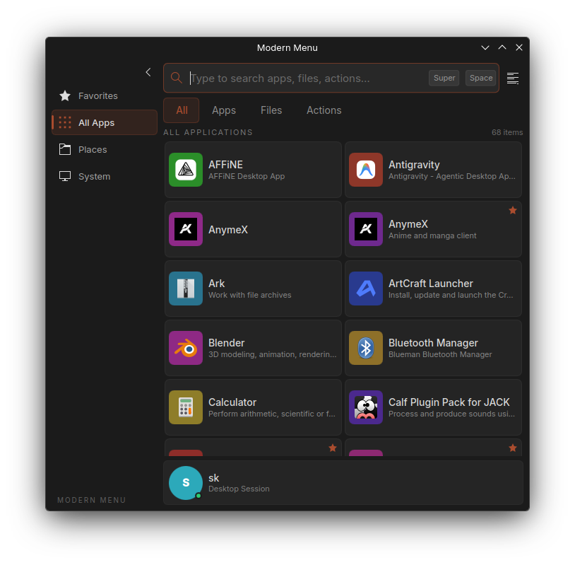

# Modern Menu

A simple, fast and good-looking application launcher for **KDE Plasma 6**.



## Features

- **All Applications** — flat, alphabetical grid of every app installed
- **Favorites** — pin apps with a star; they stay on one page
- **Places** — Home, Documents, Downloads and other KIO places
- **System** — lock, suspend, restart and shut down (with per-button toggles)
- **Search** — KRunner-powered; type and press Enter to launch the best match
- **Quick math** — type `(3200*4)+35` and the result appears as a chip while you search
- **Web results (DuckDuckGo, optional)** — instant answer + Wikipedia-style summary inside the menu; toggle in Settings (off by default)
- **Grid / List toggle** — switch between card grid and list rows (persisted)
- **Collapsible sidebar** — slim the icon rail down to icons-only mode (persisted)
- **Configurable grid** — columns (1–8), card height, popup width/height
- **User profile on/off** — hide the avatar/name in the bottom bar
- **Power buttons** — master switch plus a per-button toggle for Lock / Suspend / Restart / Shut Down
- **Uninstall apps** — right-click an app → Uninstall… (Flatpak via `flatpak uninstall`, rpm via `pkexec dnf remove`; script is bundled in the package)

Right-click any app → **Add to Favorites**, **Run**, **Uninstall…** or **Edit Applications…**.
On hover, a star appears on each app to toggle its favorite state.

## Requirements

- KDE Plasma **6.0** or later (developed and tested on Plasma 6.8.2, Fedora 44)
- KDE Frameworks 6 / Qt 6 — the standard `plasma-workspace` + `kicker` modules, already installed on any stock Plasma desktop
- Optional, only for the **Uninstall** feature: `flatpak` and/or `dnf` + `pkexec`

## Install

### From a fresh clone

```bash
git clone https://github.com/bunnywaffle/modern-menu.git
cd modern-menu
kpackagetool6 --type Plasma/Applet --install .
```

### Then activate

Restart plasmashell (brief panel flash, apps are not affected) or log out/in:

```bash
systemctl --user restart plasma-plasmashell
```

Right-click your panel → **Add Widgets…** → search **Modern Menu** → add it.

Right-click the widget → **Configure Modern Menu…** to change the icon, default view, popup width/height, grid columns/card height, and feature toggles (favorites tab, power buttons, user profile, sidebar collapse).

### Updating

```bash
git pull
kpackagetool6 --type Plasma/Applet --upgrade .
systemctl --user restart plasma-plasmashell
```

### Removing the widget

```bash
kpackagetool6 --type Plasma/Applet --remove org.sk.modernmenu
systemctl --user restart plasma-plasmashell
```

## Uninstalling applications from the menu

Right-click an app → **Uninstall…** (desktop entries only).

- **Flatpak** apps are removed with `flatpak uninstall` (user apps without a password, system apps via `pkexec`)
- **rpm/dnf** apps are removed with `pkexec dnf remove -y <package>`

If something cannot be determined or fails, the widget shows the actual error instead of silently doing nothing.

## Screenshot


## Right-click menu

- **Add to Favorites / Remove from Favorites**
- **Run**
- **Uninstall…** (desktop entries only)
- **Edit Applications…**

## Web search (optional)

Web answers come from the **DuckDuckGo Instant Answer API** (keyless, results fetched from within the menu). Enable it under *Configure Modern Menu… → General → Show web results when searching*. Google has no keyless inline-result API, so results are shown the same way instead of a Google HTML scrape.

## Notes

- Favorites are stored per applet instance using KActivitiesStats and start with a sensible default set (Dolphin, Konsole, Firefox, System Settings, Discover) on first launch.
- System actions use logind through Plasma's built-in system model; actions that are not supported on your machine are hidden automatically.

## License

[GPL-2.0-or-later](LICENSE)
